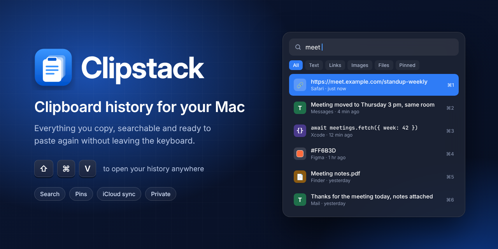
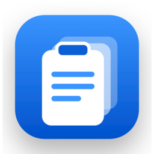
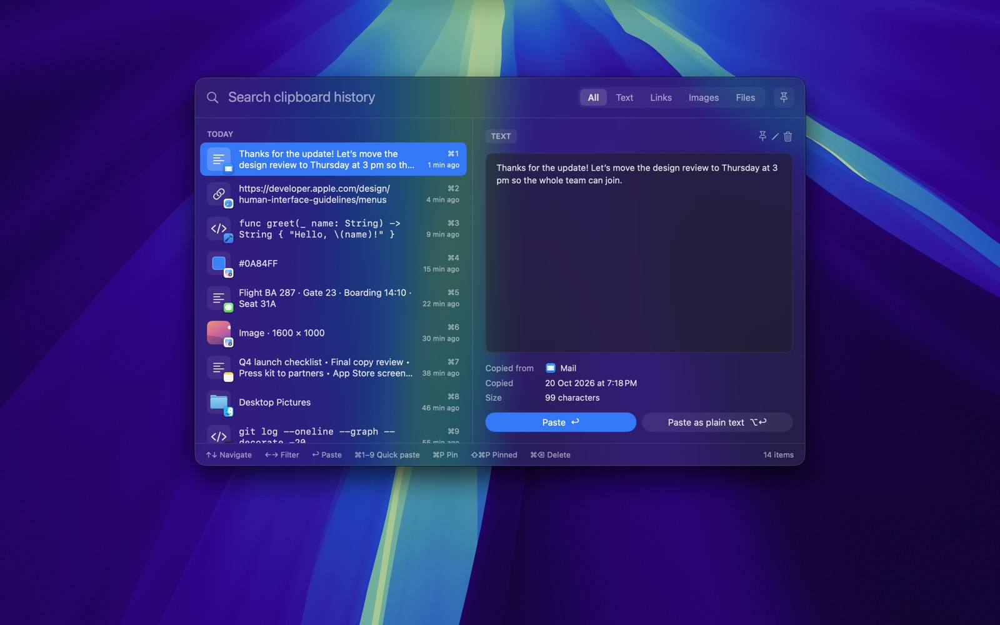
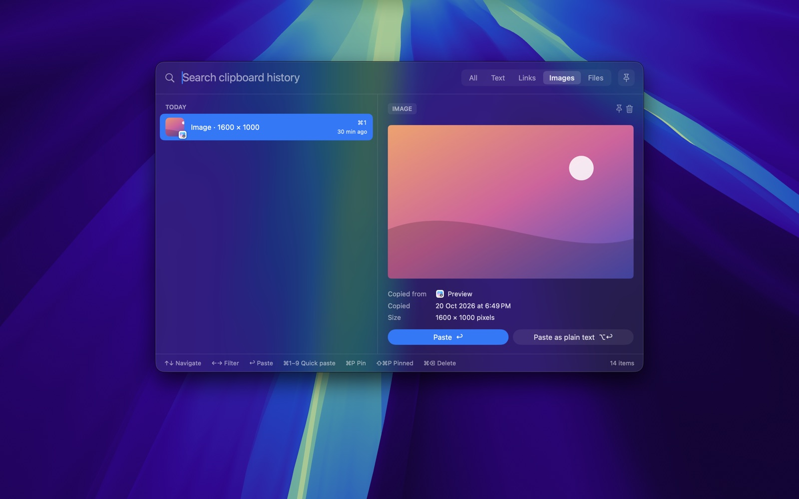
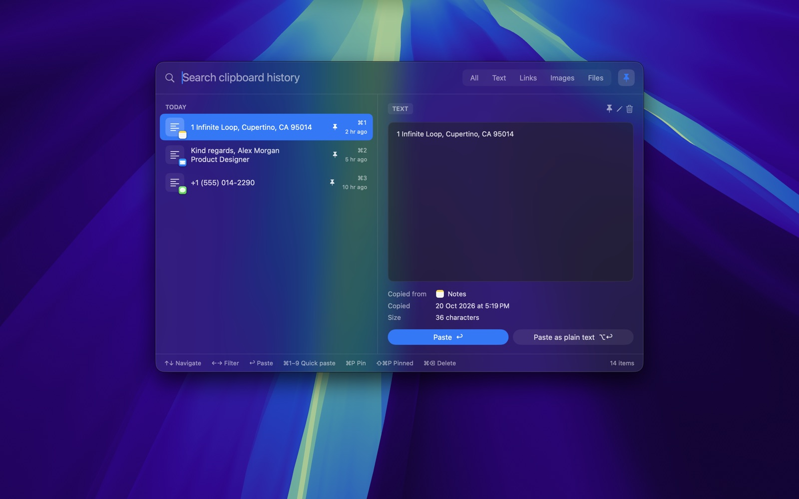
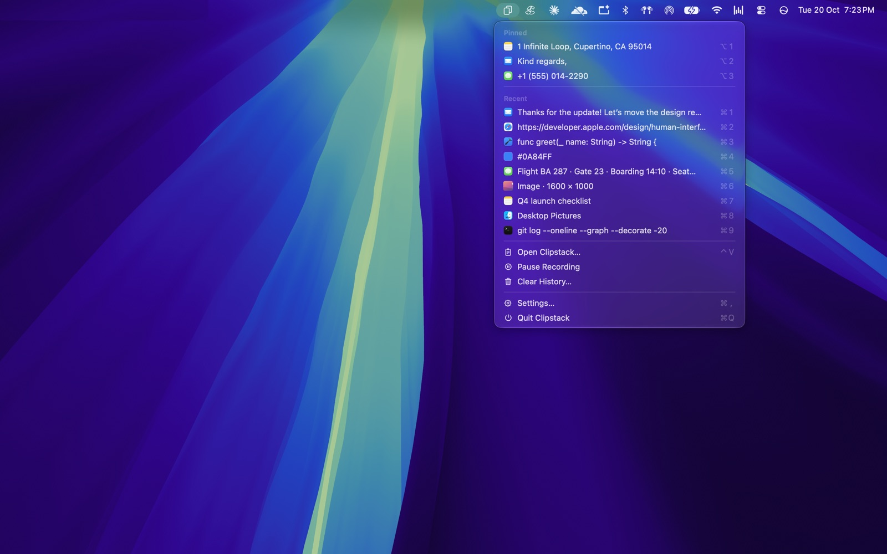
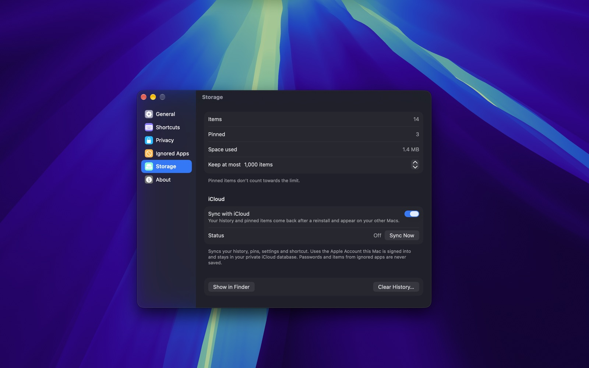

<p align="center">
  
</p>

<h1 align="center">
  <br>
  Clipstack
</h1>

<p align="center">
  <strong>Clipboard history for your Mac.</strong><br>
  Everything you copy, searchable and ready to paste again without leaving the keyboard.
</p>

<p align="center">
  <a href="https://github.com/chiranjeebhub/ClipStack/releases/latest"></a>
  
  
  <a href="https://github.com/chiranjeebhub/ClipStack/releases"></a>
  <a href="LICENSE"></a>
</p>

<p align="center">
  <a href="#install">Install</a> ·
  <a href="#features">Features</a> ·
  <a href="#screenshots">Screenshots</a> ·
  <a href="#privacy">Privacy</a> ·
  <a href="https://chiranjeebhub.github.io/clipstack-site/support">Support</a> ·
  <a href="#building-from-source">Build from source</a>
</p>

---

Clipstack is a native macOS clipboard manager built with SwiftUI and AppKit. It quietly keeps everything you copy, and a single shortcut brings it back: search, preview and paste straight into the app you're working in.

## Install

| | |
| --- | --- |
| **Mac App Store** | "ClipStack: Clipboard History" is in review and will be listed soon. |
| **Direct download** | [Download the latest DMG](https://github.com/chiranjeebhub/ClipStack/releases/latest). Signed with Developer ID, notarized by Apple, and it updates itself. |
| **Homebrew** | `brew install --cask chiranjeebhub/tap/clipstack` |

The direct download and the App Store version share the same history and settings, so install only one of them.

On first launch, Clipstack asks for Accessibility access. macOS requires this before an app can type ⌘V into other apps. Without it, choosing an item copies it to the clipboard and you paste it yourself.

## Features

- **Quick panel (⇧⌘V).** Opens a floating panel over whatever app you're in, without taking focus from it. Search as you type, filter by Text, Links, Images, Files or Pinned, and paste with ↩. ⌥↩ pastes as plain text, and ⌘1–9 pastes one of the top nine items straight away.
- **Source apps.** Every item records the app it was copied from, and the list shows that app's icon and name.
- **Rich previews.** Text, code (monospaced), links, images, files and colors each get their own preview. Edit text items in place with ⌘E.
- **Pinning.** ⌘P pins an item. Pinned items are never removed by the history limits, and they appear at the top of the menu bar menu with ⌥1–9 shortcuts.
- **Menu bar menu.** Pinned and recent items, Pause Recording, Clear History and Settings.
- **iCloud sync.** History, pinned items, settings and your shortcut sync through your private iCloud database, so they come back after a reinstall and show up on your other Macs. It's off until you turn it on.
- **Make it yours.** Launch at login, a custom global shortcut, paste behaviour, panel position, how long history is kept and the maximum number of items.

### Keyboard shortcuts

| Shortcut | Action |
| --- | --- |
| ⇧⌘V | Open the quick panel (customisable) |
| ↩ | Paste the selected item |
| ⌥↩ | Paste as plain text |
| ⌘1–9 | Paste one of the top nine items |
| ⌘P | Pin or unpin the selected item |
| ⌘E | Edit a text item |
| ⌥1–9 | Paste a pinned item from the menu bar menu |

## Screenshots

| Quick panel | Images |
| --- | --- |
|  |  |
| **Pinned items** | **Menu bar menu** |
|  |  |

<p align="center"></p>

## Privacy

- History stays on your Mac. Nothing is sent anywhere unless you turn on iCloud sync, which uses your own private iCloud database.
- Items that password managers mark as concealed or transient are never saved.
- You can list apps whose copies are never recorded, and pause recording from the menu bar at any time.
- No analytics, no tracking, no account.

Read the full [privacy policy](https://chiranjeebhub.github.io/clipstack-site/privacy).

## Requirements

macOS 14 Sonoma or later.

## Support

Questions, bugs and feature requests are welcome. See the [support page](https://chiranjeebhub.github.io/clipstack-site/support) or [open an issue](https://github.com/chiranjeebhub/ClipStack/issues).

## Building from source

Building needs Xcode 15 or later.

### Build and run

iCloud sync needs the app signed by the developer team set in `project.yml`. Sign Xcode into that team's Apple Account (Xcode › Settings › Accounts), then run:

```sh
scripts/build-signed.sh --install
```

On the first run, Xcode creates the signing certificate, app ID and iCloud container automatically. The script installs [XcodeGen](https://github.com/yonaskolb/XcodeGen) with Homebrew if it's missing.

Without a developer account, `scripts/build-app.sh` builds an ad-hoc-signed app with everything except iCloud sync:

```sh
scripts/build-app.sh
open build/Clipstack.app
```

To try changes quickly without bundling, run `swift run Clipstack`. Launch at login, iCloud sync and the app icon only work in a bundled app.

Run the tests with `swift test`.

#### Mac App Store archive

The signed app runs in the App Sandbox, as the App Store requires. Its first launch moves history and settings from earlier unsandboxed builds into the sandbox container (`Resources/container-migration.plist`). To archive a build for the App Store:

```sh
scripts/archive-appstore.sh            # exports build/AppStore/Clipstack.pkg
scripts/archive-appstore.sh --upload   # uploads the build to App Store Connect
```

Uploading needs an app record for `com.chiranjeebhub.clipstack` in App Store Connect. Before the first App Store release, deploy the CloudKit schema to production in the CloudKit Console, because App Store builds use the production environment.

#### Direct download releases

The same app is also distributed outside the App Store, as a DMG signed with Developer ID and notarized by Apple, so it opens without Gatekeeper warnings. This build (the `ClipstackDirect` target) adds [Sparkle](https://sparkle-project.org) so it updates itself, and shows Check for Updates… where the App Store build shows Rate Clipstack…. It stays sandboxed and uses the same bundle ID, so it shares history and settings with the App Store version; install only one of them.

Set up the Mac that makes releases once. The script says what it still needs from you: a Developer ID Application certificate, an app-specific password for notarization, and a signed-in GitHub CLI. It also creates the Sparkle signing key and writes the public key into `Resources/Info-Direct.plist`; commit that change and back up the private key.

```sh
scripts/setup-direct.sh
```

Then, for each release (raise `MARKETING_VERSION` in `project.yml` first):

```sh
scripts/release-direct.sh             # builds and notarizes build/Direct/Clipstack-<version>.dmg
scripts/release-direct.sh --publish   # also publishes it
```

Publishing creates a GitHub release in this repo with the DMG and the Sparkle update feed (`appcast.xml`, which installed copies read from https://github.com/chiranjeebhub/ClipStack/releases/latest/download/appcast.xml), and updates the Homebrew cask in [chiranjeebhub/homebrew-tap](https://github.com/chiranjeebhub/homebrew-tap), so people can install it with:

```sh
brew install --cask chiranjeebhub/tap/clipstack
```

### Project layout

| Path | What's there |
| --- | --- |
| `Sources/ClipboardCore` | History model, storage, search and filters, content detection, and the drawn app icon. Covered by tests. |
| `Sources/Clipstack` | The app: pasteboard monitor, global shortcut, paste service, quick panel, menu bar menu, Settings and onboarding. |
| `Sources/MakeIcon` | Renders the app icon to an `.iconset` during the build. |
| `scripts/build-signed.sh` | Builds the signed app (with iCloud) through the Xcode project generated from `project.yml`. |
| `scripts/archive-appstore.sh` | Archives the signed app and exports or uploads it for the Mac App Store. |
| `scripts/setup-direct.sh` | One-time setup for direct download releases: certificate check, Sparkle key, notarization login. |
| `scripts/release-direct.sh` | Builds, notarizes and (with `--publish`) releases the direct download DMG. |
| `packaging/clipstack.rb` | Template for the Homebrew cask. |
| `scripts/build-app.sh` | Builds an ad-hoc-signed `Clipstack.app` with SwiftPM only, without iCloud. |

## License

Clipstack is released under the [MIT License](LICENSE). Copyright © 2026 Chiranjeeb Jena.
